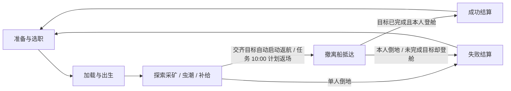

# 《掘地潜兵》首版 Demo 核心规则 v0.1

日期：2026-10-28。用途：程序、关卡、美术与测试共同使用的首版规则基线。当前范围：单人准备界面与完整玩法；多人、服务器、同步和重连全部后置。所有初始数值仍需试玩校准，未声称游戏已实现。

关联：[需求确认记录](%E6%8E%98%E5%9C%B0%E6%BD%9C%E5%85%B5_DEMO%E9%9C%80%E6%B1%82%E7%A1%AE%E8%AE%A4%E8%AE%B0%E5%BD%95.md)；[职业与装备规则](%E6%8E%98%E5%9C%B0%E6%BD%9C%E5%85%B5_DEMO%E8%81%8C%E4%B8%9A%E4%B8%8E%E8%A3%85%E5%A4%87%E8%A7%84%E5%88%99%E8%8D%89%E6%A1%88.md)。

## 1. 规则来源与目标

本文区分三类依据：

- **用户确认**：手机横屏方向，先在编辑器验证；接入现有大厅工程，作为其中一个子游戏；首版单人准备界面与完整玩法，UE 原生联网、独立服务端及 1–4 人规则均后置；枪手、钻机手、侦察兵、工程师四职业；全部关闭友伤；固定配装；本局统计、不做永久成长；可玩灰盒。
- **指定参考**：用户要求依据任务[搜寻深岩银河职业技能](codex://threads/01a18163-64ab-79c0-a894-8108e35dd1b4)补齐规则。本次已读取其中职业、武器、补给、救援、胜负和撤离问答，采用下文明确列出的机制。没有独立重查所有外部维基或承诺与原作当前版本完全一致。
- **Demo 默认**：参考未覆盖的容量、敌人、地图布局、交互距离、断线资源处理等，由本文给出可验证的默认方案。它们是本项目的设计选择，不是原作事实。

目标试玩者先按项目内部成员与受邀测试者设计。首版核心体验为：找到资源，在虫潮压力下切换作业与战斗，补充消耗，再完成撤离。后续多人阶段再验证分工、共同救援和保胜 / 救人的取舍。

首版成功标准：单人分别使用枪手、钻机手、侦察兵与工程师，都能从准备进入任务并完成采矿、交存、战斗、补给与撤离；完成与失败均可结算并重开。撤离船计划在 10 分钟返场，提前完成目标可更早返航；登舱延误会进入持续加压加时。

本文中共同作业、救援、重连和团队结算等明确标为后续的条款用于保留设计，**不构成首版实现与验收要求**。首版规则执行位置为同进程的子游戏会话 / 规则对象，不替换大厅全局 GameMode；文中涉及服务器校验与复制的描述只适用于后续联网实现，不要求先搭建服务器。宿主接入方式见[项目架构 v0.2](../docs/%E6%8E%98%E5%9C%B0%E6%BD%9C%E5%85%B5_DEMO%E9%A1%B9%E7%9B%AE%E6%9E%B6%E6%9E%84%E6%96%B9%E6%A1%88_v0.2.md)。

## 2. 首版内容与边界

| 项目 | 首版范围 |
| --- | --- |
| 职业 | 枪手、钻机手、侦察兵、工程师四职业；可重复选择；固定主/副武器、投掷物与职业工具 |
| 任务 | 每局随机生成一个水平房间网络；采矿主目标；任务中战斗、采矿、补给可同时发生 |
| 地形 | 预设网络连接随机开/半封/全封；通用矿镐可逐步打通；非连接方向由不可挖外壳限制 |
| 人数 | 首版单人、无 AI 队友；后续再实现 1–4 真人、重复选职和重连 |
| 敌人 | 全局池 6 普通 + 2 精英 + 1 固定 Boss；单局只用 3 普通 + 2 精英 + Boss，不超过 6 种；部分近战爬墙/顶棚，另有飞行与钻地行为 |
| 补给 | 采集并交存硝石，消耗共享库存呼叫四份补给 |
| 生存 | 生命与个人护盾；单人倒地即失败，不做自救或自动复活；队友救援后置 |
| 撤离 | 交存目标完成后自动返航；未完成时任务 10:00 撤离船计划返场；全体登舱且目标完成即成功 |
| 结算 | 本人任务结果、耗时、采集 / 补给 / 战斗统计；不保存等级、货币或装备成长 |
| 表现 | 灰盒模型、清晰材质与基础反馈；职业、矿点、虫潮、技能范围和任务状态可辨 |
| 暂缓 | 多人房间 / 同步 / 服务端 / 重连 / 真实队友救援、互联网、维修任务、成长、武器解锁/模组/超频/通用特长、正式美术、手机安装 |

空间站以准备界面与简易出发区表达；空降以短过渡、声音与入口舱表达，不要求制作独立空间站地图及完整空降演出。

### 2026-10-29：房间网络关卡生成方向更新（方案阶段）

用户已确认关卡改为水平方向展开的多个房间空腔网络，房间内允许固定高低起伏；预设连接可直接相接或经过管状甬道，连接岩层可以全封 / 半封且无提示，需要试挖扩展探索空间。非连接方向由不可挖外壳隔开；降落仓在初始房间内选择合法位置，门外必须能迈出一步站稳，之后允许立即遇到岩层。详见[房间网络关卡生成规则](%E6%8E%98%E5%9C%B0%E6%BD%9C%E5%85%B5_%E6%88%BF%E9%97%B4%E7%BD%91%E7%BB%9C%E5%85%B3%E5%8D%A1%E7%94%9F%E6%88%90%E8%A7%84%E5%88%99_v0.1.md)。

这替代上表“固定洞穴、主路线始终可走、随机洞穴暂缓”的后续设计前提，但本轮仅完善文档与示意，现有 Demo 仍运行固定布局。新保障路径要求通用矿镐可逐步打通，不要求开局全部畅通。矿物总预算暂保留；无提示连接使“最终可采量”不等于“及时可发现量”，首段硝石空间分配与探索耗时建议见新规则第 7 节。

### 2026-11-03：每局随机地图与四职业确认

用户确认不需要 Soul: Cave 固定布局；每次开始任务都随机生成沙盒房间网络，随机选一个合法初始房间并在其内随机放置降落仓，其余房间、连接结构、连接路径和封堵状态均按本局种子生成。初版按 6–10 间房、1–3 个回路配置，确保网络潜在连通、特殊房可达、通用矿镐能开路并可返回；完整约束见《房间网络关卡生成规则》。

四职业枪手、钻机手、侦察兵和工程师统一进入首版，固定配装、可重复选职。每局随机抽取四套虫潮编排之一；每张地图固定生成一个 Boss 房与一只固定种类 Boss。Boss 出现是固定任务遭遇，但当前不额外改变 200 晶矿解锁撤离的胜负规则。

### 2026-10-28 可读性与枪械命中反馈补充

- 场景可见物体标牌使用中文：晶矿、硝石、可破坏岩壁、运输机器人、补给舱、撤离舱、滑索、遥控炸药、冲击斧及当前关卡敌种；运行时关卡对象也使用中文描述，代码及资源路径不改名。
- 右侧全部操作按钮同时显示按键：主动作〔鼠标左键〕、交互〔E / 可长按〕、跳跃〔空格〕、换弹〔R〕、投掷〔G〕、照明〔F〕、机器人〔C〕、补给〔B〕、暂停〔P〕。
- 主副枪械及喷火直接造成有效伤害时，命中点产生短促火花，敌人闪色，准星由「+」短暂变为「×」并收缩复原。普通命中用青白色及「命中」，重甲正面减伤用橙黄色及「护甲减伤」，击杀用橙红色及「击杀」；文字确保不只依赖颜色辨别。
- 默认表现时长：敌人闪色 0.12 秒，普通 / 护甲准星反馈 0.22 秒、火花 0.24 秒，击杀准星 0.40 秒、火花 0.38 秒。属于初版表现参数，待正常速度试玩确认。
- 反馈只描述实际伤害结果，不改变命中判定、伤害或弹药消耗。空枪、击中不可破坏边界、无效伤害及持续灼烧不触发枪械确认；可破坏岩矿按 v0.3 显示独立受损/碎块反馈；击杀特效可在敌人销毁后播完，暂停冻结，结算、重开、退出清理。

### 2026-10-29：十字准心表现更新

- 按用户要求改为固定中心点＋四向短线的十字准心，替代上述整体“+ 变 ×”；有效命中、护甲减伤和击杀使用独立斜角标记，命中时仍保留瞄准中心。
- 成功发射驱动短线外跳，连射累积外扩并封顶，停火回收。当前没有动态散布、举枪瞄准或镜头后坐机制，这些动画仅表达射击节奏，不改变弹道或精度。
- 新增实际枪口遮挡、空弹匣 / 无备弹、装填、机枪热量与过热冷却提示。遮挡提示与实际开火使用相同路径查询；调试弹道线在障碍处终止。
- 岩矿破坏沿用最新破坏系统的受损 / 碎块脱落事件，使用方角标记，与敌人命中区分。
- 详细时序、可调参数、叠加和生命周期规则见[十字准心表现](%E6%8E%98%E5%9C%B0%E6%BD%9C%E5%85%B5_%E5%8D%81%E5%AD%97%E5%87%86%E5%BF%83%E8%A1%A8%E7%8E%B0.md)；实际完成的编译、自动检查与画面验收见运行记录。

### 2026-10-29：伤害飘字与弱点暴击新增设计

用户确认命中有效弱点必暴击，暂按 2 倍制作示例、倍率可调。本轮修订剔除护甲减伤、暴击击杀专属表现与连射合并。当前数字仅分普通／弱点暴击／持续伤害，每次伤害独立弹出；连射时多条叠出并在命中点附近适度散开，保留爽快感；详见[战斗伤害飘字与弱点暴击表现](%E6%8E%98%E5%9C%B0%E6%BD%9C%E5%85%B5_%E6%88%98%E6%96%97%E4%BC%A4%E5%AE%B3%E9%A3%98%E5%AD%97%E4%B8%8E%E5%BC%B1%E7%82%B9%E6%9A%B4%E5%87%BB%E8%A1%A8%E7%8E%B0_v0.1.md)。这是待实现规则与表现需求，不代表当前游戏已支持暴击增伤或伤害数字。旧代码中的方向减伤及其提示待正式接入时删除；其他任务、岩矿和生命周期实现仍以实际代码为准。

## 3. 一局流程与状态

- 作业、战斗、补给不是彼此排斥的全局阶段；虫潮中仍可采矿、交存与补给；后续多人也可在此时救援。
- 首版本地规则对象唯一维护本局阶段、MissionId、任务库存、10 分钟计划返场时间/自动提前返航时间与结算结果；后续改为服务端权威。
- 交齐任务矿后自动启动撤离船返航；不需要按 E/机器人按钮。船预计在目标完成后 60 秒抵达，最迟于任务计时 10:00 计划返场。
- 撤离船抵达后等待玩家返回；任一玩家进入撤离范围时自动开放舱门并进入集合等待。洞穴增援持续升级直至全体登舱或倒地，不设旧版 300 秒离场倒计时。
- 进入结算后终止伤害、交互、刷怪与物资变更；本局结果锁定，后到请求不能重复结算。
- 新一局生成新的 MissionId，恢复固定装备和初始地图；旧局操作与统计不能串入新局。

## 4. 房间、开局与重连

### 首版：单人准备与开始

从宿主大厅选择本游戏后进入单人准备界面，不建立网络会话：沿用宿主提供的玩家显示信息，缺省时输入本地昵称，选择四职业之一，查看固定装备，按开始进入任务。只生成 1 名玩家，不补 AI，不显示尚未实现的邀请 / 匹配 / 重连操作。

任务中不能更换职业，返回准备后可以重选。加载超时初始设 60 秒，失败返回准备并显示原因。开始按钮在加载中禁用，重复点击不重复生成角色或初始化库存。

单人按暂停菜单暂停本子游戏模拟与规则时间，包括波次、冷却、AI / 弹道和撤离倒计时；同时取消持续射击与交互，恢复后需重新按住。公共 UI 和返回流程仍响应。退出本局直接结束并回本游戏准备，不保存战斗进度；准备、暂停与结算界面另提供“返回大厅”，完成本游戏清理后回宿主大厅。后续联机菜单不会暂停服务器时间，届时单独实现。

### 后续：多人准备与开始（首版不实现）

全员选择职业并准备；队长也必须准备。更换职业取消该玩家准备。队长发起开始时，服务端再次验证人数、全员准备、地图与配置有效，再锁定参战名单。新加入者不能在开始与锁定之间绕过准备检查。

队长只是准备阶段的组织者，不拥有服务端，也不独占补给与撤离权限。队长离开后，按仍在线成员最早入房顺序转交。首版单人允许直接准备并开始，没有 AI 救援，因此单人倒地即失败。

加载默认超时 60 秒；未到达就绪状态则取消本次开局并回到准备，提示未就绪成员，不把其生成在尚未加载完成的战场中。

### 后续：掉线与重连（首版不实现）

1. 服务端确认断线后，停止该角色所有持续输入和交互，保留原角色、库存、生命与装备状态，开始 60 秒席位保留。角色留在原地，可被敌人攻击，可倒地；不能通过断线获得无敌。
2. 限时内凭原身份恢复原角色，不生成满状态的新角色；断线期间受到的伤害、倒地及队友救援均保留。
3. 超过保留时间，标记为 Abandoned，关闭本局重连资格。背包中的矿物生成一次可拾取资源包；位置必须在可走地面，必要时使用最后安全位置。弹药、工具库存不转换为公共补给。
4. 该玩家未爆炸药清除且不爆炸；已部署滑索保留到本局结束，护罩按原剩余时间结束。已结束的救援、射击或钻孔不会在重连时自动重新按住。
5. 明确点击离开任务视为放弃，立即执行离队处理；意外断线才使用保留窗口。
6. 全部玩家掉线时服务端不暂停世界。只要仍有保留席位且未倒地角色，就可等待其窗口；若所有参战角色已倒地且无自救，仍可直接失败。保留窗口全部耗尽且无人在线，结束并回收本局。
7. 断线保留期间发生结算，保存该玩家本局结果至保留时间结束；重连显示已结算结果，不恢复成可继续战斗状态。

资源包拥有唯一编号；掉线清理重复执行不能重复掉落。重连同时从两台客户端发起时，只允许一个连接控制同一角色。

## 5. 采矿、携带与任务进度

2026-10-29：岩壁与矿石升级为不规则局部破坏，规则以 [细碎破坏 v0.3](%E6%8E%98%E5%9C%B0%E6%BD%9C%E5%85%B5_%E7%BB%86%E7%A2%8E%E7%A0%B4%E5%9D%8F%E8%A7%84%E5%88%99_v0.3.md) 为准；当前仅完整固定边界不可破坏，旧整墙工作量规则废止。

2026-10-29 生成方案补充：用户确认大片连续可破坏岩层，矿团可以完全隐没其中，需要深挖才能发现；当前仅完善规则与示意，尚未接入游戏。位置、形状、深度、分区运行与可采性要求见[连续岩层与深埋矿 v0.2](%E6%8E%98%E5%9C%B0%E6%BD%9C%E5%85%B5_%E8%BF%9E%E7%BB%AD%E5%B2%A9%E5%B1%82%E4%B8%8E%E6%B7%B1%E5%9F%8B%E7%9F%BF%E7%94%9F%E6%88%90%E8%A7%84%E5%88%99_v0.2.md)。地图总矿量与下表保底继续适用，深矿从原预算划拨；建议没有定位机制的完全隐藏深矿暂不计入可发现路线保底，比例与经济调整仍待试玩。

### 矿物种类与地图初值

| 内容 | Demo 初值 | 规则 |
| --- | --- | --- |
| 任务晶矿 | 主目标交存 200 单位，地图放置 300 单位 | 至少 240 单位位于不依赖职业工具的主路线；余量用于探索选择 |
| 补给硝石 | 地图放置 240 单位 | 首段可达区域提供至少 80 单位；主路线总量至少 160，职业捷径不能垄断必要补给 |
| 个人容量 | 每种矿独立上限 40 单位 | 不计算重量或减速；UI 分别显示携带晶矿、硝石 |
| 开局团队库存 | 两种均为 0 | 弹药和工具按固定配装满额出发 |

上述矿量、容量均是本 Demo 初始建议。任务矿与补给矿分开，呼叫补给不减少任务完成进度。任务目标首版不随人数变化；敌人强度另按人数调节。

### 开采与拾取

- 所有职业均可用矿镐长按开采；矿镐不消耗弹药。2026-10-29 更新：枪械、动力钻及爆炸同样可局部破坏矿石，产出地面矿块，不销毁资源；详见 [细碎破坏规则 v0.3](%E6%8E%98%E5%9C%B0%E6%BD%9C%E5%85%B5_%E7%BB%86%E7%A2%8E%E7%A0%B4%E5%9D%8F%E8%A7%84%E5%88%99_v0.3.md)。
- 每个矿块预先配置唯一编号、开采工作量与整数产量。多人开采共享工作进度，完成时只生成一次矿物。
- 产出先成为地上可拾取矿物，近距离自动拾取至容量上限；剩余部分保留原地。无伤害、爆炸或正常清理逻辑会删除未拾取的任务资源。
- 角色倒地保留背包，救起后继续持有；仅离队清理产生资源包，结算后结束本局物资。
- 任何玩家携带的矿物都不提前计入任务进度或可用补给库存。

### 交存

靠近运输机器人并长按交互，以每秒 20 单位的初始速度交存，顺序为任务晶矿再硝石。移动离开、松手、倒地、断线或切换行动后结束；已交存部分保留，未交存部分仍在背包。时间累积为转移额度，只转移整数单位：每次转移量为当前矿种携带量与累计额度向下取整的较小值，转移后扣除等量额度；持续交互时余下不足 1 单位的额度保留，中断时清零，不扣除任何未转移矿物。

每次实际转移必须同时从个人库存扣除、向团队库存增加，数量相等。客户端不提交“我的库存应变成多少”，只提交交存意图。任务进度显示 `min(已交存晶矿, 目标量)`，实际交存总量另计统计，不能因 UI 封顶而丢失资源。

首版由本地规则端处理一次有效转移；重复请求、背包为空或已结束交互不能再次增加进度。后续多人可以同时交存，由服务端分别处理库存。

### 运输机器人

Demo 使用地面移动机器人，不复制参考中的爬墙能力。关卡预设可到达的停靠节点；玩家可呼叫机器人前往自身附近的有效节点。机器人不受伤、不需要保护。

采用“当前有效请求先完成”的默认规则，移动中新的呼叫返回忙碌提示，避免多人反复抢控制。机器人停稳后可交存。连续 10 秒无法取得路径进展时，提示故障并复位到已验证的安全节点；复位不能生成矿物或改变共享库存。

撤离开始后机器人自动返回撤离舱，停止响应普通呼叫，并沿玩家可通行路线给出路标。首版优先保证路线可靠，不卡在职业限定通路或不可攀爬表面。

## 6. 补给规则

采用指定参考的基础结构：**80 硝石 / 舱，4 份 / 舱，各项容量的 50% / 份；允许同一人多次领取。**

### 呼叫

- 任意未倒地队员可选有效地面呼叫。必须使用已交存的团队硝石，个人背包不计入可用金额。
- 可呼叫阶段为任务与撤离；结果锁定后不能呼叫。落点不能在舱门、必经窄口、墙内或不可达位置，使用预设安全区域与碰撞检查。
- 规则端核验库存与落点后原子扣除 80，生成唯一补给订单，再显示倒计时。首版重复点击不能多扣 / 多生成；后续多人竞争最后 80 时只能一个成功。
- 初始到达时间设 8 秒；落地过程不伤害、击飞或困住队员，也不以真实地形钻孔为前提。
- 生成失败时同一订单至多退款一次；成功落地后不退矿。错误重试不能获得两舱或重复退款。

### 领取与恢复

每舱 4 个独立补给份额，靠近其中一个长按 3 秒领取。单份同时只允许一个领取动作；中断释放占用并重置该份进度，不扣份额。完成时在一个规则事务中标记已用并恢复资源；后续多人也必须保证独占。

| 资源 | 每份恢复方式 |
| --- | --- |
| 主武器、副武器总携弹量 | 分别增加最大总携弹量的 50%；整数弹药统一向上取整；装填入枪与储备之和不超过总上限 |
| 投掷物、滑索弹、护盾充能、炸药包 | 分别增加 `ceil(最大容量 × 0.5)`，不超过各自容量 |
| 动力钻燃料、喷火器燃料 | 增加最大容量的 50%，浮点保存；喷火燃料按总携带上限计 |
| 生命 | 增加最大生命的 50%，不超过生命上限 |
| 个人护盾 | 不直接补满，继续遵循自然恢复与护罩规则 |
| 冷却、热量、已部署物 | 不清除冷却或机枪热量，不额外生成已部署物 |

对整数容量 C、当前量 x：`新量 = min(C, x + ceil(0.5 × C))`。生命与连续燃料使用 `min(C, x + 0.5 × C)`，仅显示时取整。例：容量 100、当前 20 → 70；工具上限 3、剩 0 → 2；生命上限 100、剩 80 → 100。

首版约定补给先补储备弹药，随后正常换弹；无弹匣的机枪 / 钻机直接加至总池。不能通过补给改变固定装备类型。

不会强制每人一份；四人可以协商多拿，单人可以分次用完四份。UI 明示团队库存、每舱剩余份数和领取者。Demo 默认所有可恢复项均已满时拒绝领取并提示，避免纯误触消耗。

照明棒采用独立自动恢复，不消耗硝石；初始携带上限 4 根，每 15 秒恢复 1 根、每根照明 30 秒。红糖、损坏补给舱与维修补给不进入首版。

## 7. 生存、倒地与救援

Demo 默认生命上限 100，个人护盾上限 50。敌人伤害先扣个人护盾，余量扣生命；脱离有效伤害 6 秒后，以每秒 10 点恢复个人护盾，直到满值。枪手区域护罩内恢复速率初始取每秒 25 点，并允许立即开始恢复；多个罩取最高值。

全部友伤为 0；本 Demo 同时默认关闭自身武器 / 爆炸伤害。地图越界仍触发倒地，并将救援位置放在最后安全地面，避免掉到关卡外无法救援。

首版单人生命降到 0，立即停止动作并进入失败结算，不等待不存在的队友；不能因后续预留了救援状态就卡在永不结束的倒地画面。

后续多人中，生命降到 0 进入可救援倒地：停止移动、射击、工具与持续交互，保留装备与矿物，可呼救、查看队友；敌人不继续攻击倒地者。无流血倒计时，不限制普通救援次数。

### 后续多人：救援（首版不实现）

- 所有未倒地职业均可在 2 米内、有视线时长按交互救援。基础单人 6 秒，不消耗物品。
- 救援期间不能射击或使用其他工具，仍可被敌人伤害。受击本身不直接重置进度；松手、离开范围、失去视线、切换动作、自己倒地或断线，才停止该人的贡献。
- 多人共同救援时速度线性相加。若 n 人持续救援，每秒增加 `n / 6` 的完成比例；进度范围 [0,1]。两人从零持续救援需 3 秒，三人需 2 秒。
- 只要仍有至少一名有效救援者，已有进度保留；有效救援者变为 0 时立即归零。这与钻孔 / 交存的保留进度规则不同，UI 应明确。
- 救起恢复最大生命的 40%、个人护盾为 0；提供 2 秒受伤保护作为白盒默认，界面显示保护状态，结束后按普通规则受伤。弹药和工具不刷新，保护期不能叠加为永久免伤。
- 完成救援只发生一次；并发完成、重连或重复消息不得重复回血或重复增加救援次数。

### 首版单人失败与后续团灭

首版没有钢铁意志、自救、AI 救援或自动复活，单人倒地直接失败。后续多人阶段中，所有仍参与本局角色均倒地且没有舱内正常角色时任务失败；站立但掉线角色遵循第 4 节限时规则，不因其他人退出就复活倒地者。

## 8. 虫潮与敌人

此节为 Demo 默认，不声称来自参考聊天的精确规则。首版固定 N=1；多人缩放公式保留为后续建议，不实现多客户端或动态离队人数处理。

- 初始三类：近战虫追击撕咬；喷吐虫在可见射程内使用可观察弹道；重甲虫正面减伤、背部弱点，提高绕侧与协作价值。数值与命中部位独立配置。
- **2026-11-03 更新：**上一条“三类敌人”及“重甲虫正面减伤”是早期基线，现由《掘地潜兵_地下敌人及技能设计_v0.1.md》替代。全局池含攀行、钩颚、钻地、酸囊、晶棘、掠翼六种普通怪，裂背冲锋、棱背炮两种精英和固定渊脊母虫 Boss；每局波次编排只激活三种普通怪，合计最多六种。弱点按真实身体部位命中触发暴击，取消方向护甲减伤。
- 常规敌人以地面导航为主；只在玩家看不到且可走到战区的点生成。指定岩壁打开后启用对应路线，不在玩家面前凭空刷新或在安全舱内生成。
- 任务开始后 45 秒触发首波，此后约每 60 秒开一波，8 分钟左右达到最高常规强度；每波提前 10 秒提示。每局随机抽取四套敌群方案之一，本局固定使用，波次种类比例和刷新方位见《地下敌人及技能设计》。
- 基础波次总投放量从 30 只起，每波增加 6 只；各波分成 5–8 只的刷新包，不同时一口气生成整波。后续波次的精英数按方案增加；软并发上限由 12 逐步升至 36。
- 8:00 后继续每 30 秒添加增援包；第 k 包总量为 `6 + 6k`，精英数随 k 增长。软并发上限每 30 秒增加 6，首版硬性能上限暂设 72 并保留未刷队列。玩家/全体登舱或死亡时清空队列。
- 每张随机地图保证一个 Boss 房；固定 Boss 渊脊母虫在 6:30 唤醒或玩家先进入时提前唤醒，每局只生成一次。Boss 不改变 200 晶矿主目标，不阻断波次在其它房间继续加压。
- 怪物未清空不阻止作业或撤离。普通攻击 / 矿镐基础近战与照明在弹药耗尽后仍可用，但任务不承诺任何资源管理错误均可无风险挽回。
- 卡住且无法接近任何有效目标的敌人由本局规则端超时回收，并计入诊断；不能借修复卡怪无限刷新任务资源或奖励。

首版分别用枪手、钻机手、侦察兵、工程师进行单人调参，记录弹药余量、补给次数、倒地次数、30+基础波的实际承受数量及提前/计划撤离用时；四套波次均需覆盖。进入多人阶段后再测 2 / 4 人。未采集数据前，不宣称人数曲线平衡。

## 9. 撤离与胜负

首版只有本人：单局目标时长约 10 分钟。交存 200 晶矿后，撤离船自动开始返航；无需玩家呼叫。撤离船预计在目标完成后 60 秒抵达，若未完成目标则最晚于地图时间 10:00 返场。玩家返回船边时舱门自动开放并等待登舱；全体当前玩家进入舱内安全区后自动起飞。敌人持续增加，直到全体登舱或玩家生命归零。下文多人和掉线角色相关规则为后续扩展。

### 自动返航与计划返场

- 任务晶矿交存达到 200 时广播“主目标完成，撤离船正在返航”。事件不可重复触发，不需要 E 键、机器人按钮或队长权限。
- 提前返航航行时间白盒初值 60 秒；撤离船抵达本局随机指定的撤离房后等待玩家返回，任一玩家靠近时舱门自动打开。
- 若目标未在此前完成，撤离船于任务开始后 10:00 自动返场。10:00 是返场时刻，不是失败截止时间；撤离船到达后持续等待，不会自动离场。
- 撤离房与降落房不同。运输机器人沿已验证可达的通用路线返回并留下路标；玩家沿已打开通路前往。船抵达后进入等待登舱状态。

### 开门与登舱

- 玩家返回已到达的撤离船附近时舱门自动打开；机器人如未归舱仍按自身路线处理，不阻止玩家进入撤离安全区。
- 仅进入舱内安全区才计为登舱；站在舱外、坡道或门口不算。登舱需角色未倒地，尸体 / 倒地角色进入体积不能算成功。
- 舱内未倒地角色不受敌人伤害；仍可在任务结束前走出，走出即取消其当前登舱状态，不因曾经进去过就永久算撤离。
- HUD 在返场前显示撤离船预计到达时间；返场后显示登舱提示和当前增援压力。单人不显示队友/投票信息。

### 判定

| 情况 | 结果 |
| --- | --- |
| 任务目标完成且所有当前玩家进入撤离船安全区 | 自动起飞并结算成功 |
| 目标未完成但所有当前玩家进入安全区 | 自动起飞并以主目标未完成结算失败 |
| 玩家倒地（首版单人） | 立即任务失败；不等待救援或返场 |
| 撤离船在 10:00 到达 | 不自动失败；停在撤离房等待玩家返回，增援继续升级 |
| 交存目标完成 | 自动开始返航；白盒 60 秒后船到达，不需要交互呼叫 |
| （多人后续）全体当前玩家进入安全区 | 自动起飞；倒地成员必须先被救起并登舱 |
| （多人后续）仅部分玩家登舱 | 船继续等待其它当前玩家；增援继续升级 |
| 有当前队员未登舱 | 撤离船继续等待并持续增援；仍在线/席位保留者必须全部登舱，不提前起飞 |
| 主动离队或断线超时 | 标记 Abandoned，不共享后续本局结果收益；不阻塞提前起飞条件 |

断线保留中的站立角色也属于“未倒地队员”，若仍在舱外会阻止多人提前起飞；已在舱内的保留角色保持其服务器位置与安全状态，允许被计入多人登舱结果。

首版以本子游戏统一规则时钟为准，暂停同时暂停波次增长、10 分钟计划返场与返航航行时间；返场后等待不设固定截止时间。宿主公共流程不因本游戏暂停而停止。后续联网改用服务器任务时钟与舱内名单，客户端插值显示。

## 10. 结算与重开

用户已确认首版不做永久成长。结果面板显示：

首版仅展示自己的本局结果、耗时、矿物交存、补给领取、战斗统计和失败原因；不展示无实际队友的救援与人员分配面板。下面的多人结果字段保留为后续设计。

- 本局团队成功 / 失败及原因、主目标完成量、任务耗时。
- 每位参战玩家：Extracted 或 Abandoned；倒地次数、救援次数、交存矿量、补给领取次数、击杀 / 伤害统计。
- 全队成功撤离人数与全员撤离标记，体现救齐队友的成果；原作“存活奖励”在首版用结果统计表达，不实际发放经验、货币或解锁资源。

团队成功需要所有仍在本局的玩家登舱；Abandoned 玩家不再阻塞返航。失败局同样可查看统计，但不把尚未交存的矿转入下一局。

返回准备后保留昵称与可选职业偏好，清空本局生命、库存、部署物、矿脉状态、虫潮计时与统计。新局恢复固定配装；不保存中途战斗进度。允许本地保存灵敏度、音量等设置以及测试日志，这不构成永久成长。

## 11. 横屏操作与信息反馈

统一动作：移动、视角、主动作、换弹、切换装备、投掷物、照明、交互、跳跃、标记、呼叫机器人与呼叫补给。输入层提供触摸和键鼠映射，业务层共用同一意图接口。

默认编辑器键鼠：WASD 移动，鼠标转视角，左键当前装备主动作，R 换弹，1–5 切换主 / 副 / 矿镐 / 两工具，G 投掷，F 照明，E 长按交互，Space 跳跃，鼠标中键标记，C 呼叫机器人，B 进入补给落点预览。按键均可在配置映射中调整。

触屏：左摇杆移动、右侧空白区滑动镜头；右侧主动作 / 跳跃 / 情境交互，装备栏切换；标记、照明与投掷使用小型快捷按钮。补给与机器人入口进入工具菜单，避免长期占据主要战斗区域。

首版 HUD 必需：生命 / 护盾、当前装备资源、个人携带与已交存量、虫潮警告、交互进度、撤离船预计返场/航行时间、撤离方向/登舱提示和持续增援强度。后续多人再增加队友状态、登舱人数、连接与重连状态。交互提示只显示当前优先目标；多人阶段默认救援优先于普通作业。

辅助瞄准默认仅减缓准星靠近敌人时的视角速度，并在很小角度内辅助，不自动开枪、不穿墙、不锁队友；具体验证参数待输入手感测试。近墙射击同时验证镜头瞄准点与枪口到目标的遮挡，避免越肩镜头隔墙命中。

## 12. 资源与数值校验

资源守恒要求：对每种矿，`初始放置量 = 未开采量 + 地上掉落量 + 所有玩家携带量 + 公共库存余额 + 净消耗量`。各量单位均为整数矿物单位，非负；净消耗量为呼叫补给已扣数量减已退款数量，任务晶矿净消耗量为 0。累计交存量是统计字段，不能再与公共库存余额同时加入等式。例：240 硝石中已交存并花掉 80 呼叫一舱，剩余地图矿 160、库存余额 0、净消耗 80，仍满足 240 = 160 + 0 + 80；生成失败退款后余额 80、净消耗 0。交存、拾取、离队掉包只在这些容器间转移，不凭界面或请求中的数值增发。

资源配置整数且非负；ID 唯一，引用存在。至少保证无需职业工具可获得的任务矿 ≥ 目标，硝石存在至少一次补给的完整组合。矿包、补给份额与部署物采用唯一标识，结算使用唯一 MissionId。

初始资源检查例：地图硝石 240，单舱 80，最多可正常呼叫 3 舱，共 12 份；四人均分时每人最多 3 份，每份按各自上限增加 50%，不会跨容量累积。单人可分次领取 12 份，这是参考共享补给规则与当前固定矿量带来的难度差异，必须通过实际试玩评估，不能直接当作平衡成立。

救援状态与补给状态的整数计数仅在成功提交时增加一次；中断或重复请求不得计数。配置中的百分比为比例 [0,1]，时间与距离必须大于 0，角度、人数和容量需在声明范围内。

## 13. 贯穿案例与验收

### 首版单人案例

选择枪手进入随机地图，分批采集并交存总计 80 硝石，使用机枪应对从 30 只起逐波增大的虫潮，需要恢复时部署护罩并领取补给；交存 200 晶矿后自动触发撤离船返航，预计 60 秒抵达。玩家沿已打通路线赶至随机撤离房，全体登舱后成功结算。若尚未完成目标，撤离船在 10:00 计划返场并等待玩家。重开可选择另外三个职业之一，四职业分别进行单人验证。

失败分支：任一战斗中生命归零立即失败；撤离船抵达后仍未交齐 200 晶矿却登舱，则以主目标未完成结算失败。若玩家继续作业，波次总量与精英质量不断提升，直到登舱或死亡。暂停同时冻结任务计时、波次增长和返航航行时间。结算重开恢复固定配装，资源与部署物不跨局保留。

首版验收必须覆盖：四职业分别成功；随机地图种子可复现且随机拓扑均可通行/返回；四套波次均被抽取覆盖、Boss 每局固定生成；单人倒地失败；撤离超时；矿满后的部分拾取；多次点击补给 / 领取不重复生效；暂停恢复；岩壁打开后的实际通路；成功 / 失败后重开。下面多人案例与测试留待后续阶段。

### 后续多人案例与验收（首版不执行）

两人分别选择枪手与钻机手。进入洞穴后开采硝石，各携带 40 并交存，团队库存达到 80。枪手呼叫补给；钻机手采集晶矿，遇虫潮后切换喷火器。枪手受伤倒地，钻机手清出安全区并持续救援 6 秒，枪手以 40 生命恢复。两人按需领取补给，完成晶矿交存。

任务矿交齐后自动启动撤离船返航，不由单个队员按键发起。钻机手开通指定捷径，枪手掩护并协助救援；全体仍在本局的玩家必须登舱后才自动起飞。若有人未归队，撤离船持续等待且虫潮增援继续增加；下一局所有人恢复固定装备，没有永久数值收益。

| 检查类别 | 必须覆盖 |
| --- | --- |
| 正常流程 | 1、2、4 人完整成功；重复职业队伍成功；任务完成后可继续作业再撤离 |
| 物资边界 | 背包满与部分拾取；多人最后一击采矿；双人同时花最后 80 硝石；两人争同一补给份；全满领取；工具奇数容量取整 |
| 救援 | 单人 / 多人救援；一人退出仍继续；全部中断归零；受伤但未倒地；全队倒地；单人倒地 |
| 撤离 | 舱外坡道不算；机器人卡住最后 10 秒开门；只有一人撤离；所有清醒者入舱提前结束；出舱取消状态；无人赶上 |
| 网络恢复 | 采矿 / 补给 / 救援 / 起爆中断线；限时重连；超时掉包；结算期间重连；重复连接同一角色 |
| 重开 | 成功与失败后重开；旧请求不污染新局；资源与怪物不残留；没有重复 HUD 或输入绑定 |

当前证据仅为文档与公式检查；以上运行验收需在项目实现后执行，用户试玩负责验证节奏、趣味与手感。
